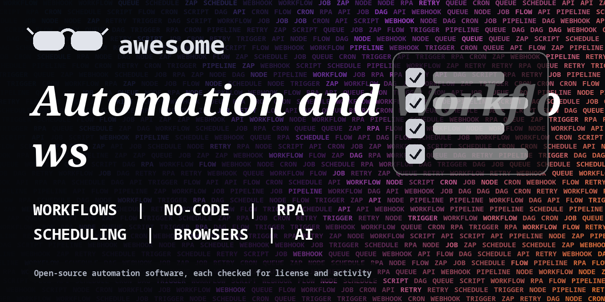

<h1 align="center">Awesome Automation and Workflows</h1>

> Open-source workflow engines, no-code builders, RPA, scheduling and browser automation for repeatable work. Every entry shows its license.

**Rules of this list:** every repo exists, is public, is not archived, states a license and has had a commit in the last year. One plain sentence each. Star counts and claims are the authors' own, we did not test every tool. Checked 2026-10-18. See [CONTRIBUTING.md](CONTRIBUTING.md).

## Contents

- [No-code and low-code automation](#no-code-and-low-code-automation)
- [Workflow and orchestration engines](#workflow-and-orchestration-engines)
- [Job queues and schedulers](#job-queues-and-schedulers)
- [Browser and web automation](#browser-and-web-automation)
- [Desktop and RPA](#desktop-and-rpa)
- [Integrations and connectors](#integrations-and-connectors)
- [AI-driven automation](#ai-driven-automation)
- [Home and device automation](#home-and-device-automation)
- [How to choose](#how-to-choose)
- [Contributing](#contributing)

## No-code and low-code automation

Visual builders like Zapier you host yourself.

- [activepieces/activepieces](https://github.com/activepieces/activepieces)  - Open-source no-code automation, an alternative to Zapier. _(check repo)_
- [automatisch/automatisch](https://github.com/automatisch/automatisch)  - Open-source Zapier alternative for business automation. _(check repo)_
- [huginn/huginn](https://github.com/huginn/huginn)  - Build agents that watch the web and act on your behalf. _(MIT)_
- [n8n-io/n8n](https://github.com/n8n-io/n8n)  - Visual workflow automation with hundreds of integrations. Fair-code license with limits. _(check repo)_
- [node-red/node-red](https://github.com/node-red/node-red)  - Low-code, flow-based programming for hardware and APIs. _(Apache-2.0)_
- [windmill-labs/windmill](https://github.com/windmill-labs/windmill)  - Turn scripts into workflows, apps and internal tools. _(check repo)_

## Workflow and orchestration engines

Code-first engines for reliable jobs.

- [apache/airflow](https://github.com/apache/airflow)  - Platform to author, schedule and monitor workflows. _(Apache-2.0)_
- [argoproj/argo-workflows](https://github.com/argoproj/argo-workflows)  - Container-native workflow engine for Kubernetes. _(Apache-2.0)_
- [conductor-oss/conductor](https://github.com/conductor-oss/conductor)  - Orchestration engine for microservices and workflows. _(Apache-2.0)_
- [dagster-io/dagster](https://github.com/dagster-io/dagster)  - Orchestrator for data assets and pipelines. _(Apache-2.0)_
- [hatchet-dev/hatchet](https://github.com/hatchet-dev/hatchet)  - Background task and workflow platform. _(MIT)_
- [inngest/inngest](https://github.com/inngest/inngest)  - Event-driven durable functions and workflows. _(check repo)_
- [kestra-io/kestra](https://github.com/kestra-io/kestra)  - Event-driven orchestration platform with a declarative YAML approach. _(Apache-2.0)_
- [PrefectHQ/prefect](https://github.com/PrefectHQ/prefect)  - Workflow orchestration for Python data and automation jobs. _(Apache-2.0)_
- [spotify/luigi](https://github.com/spotify/luigi)  - Python module for building complex batch pipelines. _(Apache-2.0)_
- [temporalio/temporal](https://github.com/temporalio/temporal)  - Durable execution platform for reliable workflows. _(MIT)_

## Job queues and schedulers

Run work on a clock or from a queue.

- [agronholm/apscheduler](https://github.com/agronholm/apscheduler)  - Advanced Python scheduler for in-process jobs. _(MIT)_
- [celery/celery](https://github.com/celery/celery)  - Distributed task queue for Python. _(check repo)_
- [citusdata/pg_cron](https://github.com/citusdata/pg_cron)  - Run periodic jobs inside Postgres. _(PostgreSQL)_
- [go-co-op/gocron](https://github.com/go-co-op/gocron)  - Job scheduling library for Go. _(MIT)_
- [hibiken/asynq](https://github.com/hibiken/asynq)  - Simple, reliable distributed task queue in Go. _(MIT)_
- [sidekiq/sidekiq](https://github.com/sidekiq/sidekiq)  - Background jobs for Ruby. _(check repo)_
- [taskforcesh/bullmq](https://github.com/taskforcesh/bullmq)  - Message queue and job processing for Node.js and Python. _(MIT)_

## Browser and web automation

Drive a browser for testing or tasks.

- [browser-use/browser-use](https://github.com/browser-use/browser-use)  - Make websites accessible for AI agents. _(MIT)_
- [browserless/browserless](https://github.com/browserless/browserless)  - Headless browser service for automation and scraping. _(check repo)_
- [cypress-io/cypress](https://github.com/cypress-io/cypress)  - Fast browser testing and automation tool. _(MIT)_
- [microsoft/playwright](https://github.com/microsoft/playwright)  - Reliable end-to-end testing and automation across browsers. _(Apache-2.0)_
- [microsoft/playwright-mcp](https://github.com/microsoft/playwright-mcp)  - MCP server that lets assistants drive a browser with Playwright. _(Apache-2.0)_
- [puppeteer/puppeteer](https://github.com/puppeteer/puppeteer)  - JavaScript API to control Chrome and Firefox. _(Apache-2.0)_
- [SeleniumHQ/selenium](https://github.com/SeleniumHQ/selenium)  - Browser automation framework and ecosystem. _(Apache-2.0)_

## Desktop and RPA

Automate desktop apps and files.

- [AutoHotkey/AutoHotkey](https://github.com/AutoHotkey/AutoHotkey)  - Scripting language for desktop automation on Windows. _(GPL-2.0)_
- [autokey/autokey](https://github.com/autokey/autokey)  - Desktop automation utility for Linux. _(GPL-3.0)_
- [robocorp/rpaframework](https://github.com/robocorp/rpaframework)  - Open-source libraries and tools for robotic process automation. _(Apache-2.0)_
- [robotframework/robotframework](https://github.com/robotframework/robotframework)  - Generic automation framework for acceptance testing and RPA. _(Apache-2.0)_

## Integrations and connectors

Move data between services.

- [airbytehq/airbyte](https://github.com/airbytehq/airbyte)  - Data integration platform with many connectors. _(check repo)_
- [apache/camel](https://github.com/apache/camel)  - Integration framework with many connectors. _(Apache-2.0)_
- [apache/nifi](https://github.com/apache/nifi)  - Automate data flow between systems. _(Apache-2.0)_
- [dlt-hub/dlt](https://github.com/dlt-hub/dlt)  - Python library for loading data from many sources. _(Apache-2.0)_
- [mage-ai/mage-ai](https://github.com/mage-ai/mage-ai)  - Tool for building and running data pipelines. _(Apache-2.0)_
- [meltano/meltano](https://github.com/meltano/meltano)  - Declarative, code-first data integration engine. _(MIT)_

## AI-driven automation

Workflows that call LLMs and agents.

- [crewAIInc/crewAI](https://github.com/crewAIInc/crewAI)  - Framework for orchestrating role-playing AI agents. _(MIT)_
- [langchain-ai/langgraph](https://github.com/langchain-ai/langgraph)  - Library for building stateful, multi-step agents as graphs. _(MIT)_
- [langgenius/dify](https://github.com/langgenius/dify)  - Platform for building LLM apps with workflows and RAG. _(check repo)_

## Home and device automation

Automate smart devices and local services.

- [eclipse-mosquitto/mosquitto](https://github.com/eclipse-mosquitto/mosquitto)  - Open-source MQTT message broker. _(check repo)_
- [home-assistant/core](https://github.com/home-assistant/core)  - Open-source home automation that puts local control first. _(Apache-2.0)_
- [ioBroker/ioBroker](https://github.com/ioBroker/ioBroker)  - Integration platform for the Internet of Things. _(MIT)_
- [openhab/openhab-core](https://github.com/openhab/openhab-core)  - Vendor-neutral home automation platform. _(EPL-2.0)_

## How to choose

- **Start with one boring task** you do every week.
- **Handle failures.** Add retries, alerts and logs before you depend on a flow.
- **Keep secrets out of workflows.** Use the tool's credential store.
- **Check the license.** Some popular engines are fair-code with limits for resale.

## Contributing

See [CONTRIBUTING.md](CONTRIBUTING.md). One entry per pull request, plain words, real sources only.

## About

Maintained by [@devanasolver](https://github.com/devanasolver). Listings follow the rules in CONTRIBUTING.

## Sponsor me

If this list is useful, [buy me a coffee](https://buymeacoffee.com/isaac49).
